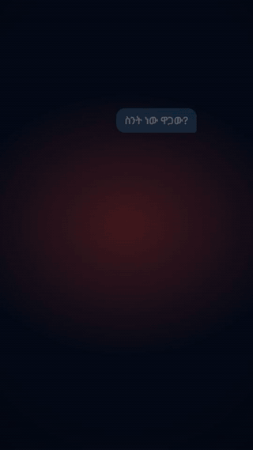

# promo-video-remotion

**Promo videos in code.** An agent skill that turns a brief into a finished vertical ad, product explainer or motion-graphics clip with [Remotion](https://www.remotion.dev/) — storyboard → design tokens → React scenes → synthesized sound → voiceover → verified MP4.

No timeline editor, no subscriptions, no stock templates. You describe the video; the agent writes the scenes, renders, looks at stills, fixes what's broken, and hands you an MP4.



[Watch the full demo](docs/demo.mp4) — 45 s, 540×960, music + SFX, no voiceover.

## Make your first video

1. **Install the skill** (see [Install](#install)) — it is one folder.
2. **Ask your agent for the video.** Start with something concrete:

   > Use the promo-video-remotion skill to make a 30-second vertical ad for **Nile Coffee**, a specialty roaster in Addis. Warm, editorial, light background. Show the bag, the pour, and the delivery box. End with "Order fresh." and nilecoffee.com. English voiceover, female.

3. **Preview, then render.** The agent runs `npm start` for Studio and `npm run render` for the MP4.

If your agent can't render (some sandboxes block Chrome), it will typecheck the project, zip it, and tell you to render locally. Ask for that explicitly if needed.

## What you can ask for

| Brief | Preset it should pick |
|---|---|
| Fintech app launch, tech product, premium brand film | `premium-dark` (default) |
| Wellness, fashion, education, B2B SaaS | `editorial-light` |
| Consumer app, event, D2C drop, youth campaign | `bold-social` |
| Quote, statistic, manifesto, no product footage | `kinetic-type` |

The preset changes palette, type, pacing and audio — not just colors. Full spec: [`references/style-presets.md`](references/style-presets.md). Custom directions are supported; the skill asks six questions and writes them into `src/theme.ts`.

### Example prompts

- *"45-second TikTok ad for a savings app. Bold social style, Amharic voiceover, show a phone, a rising balance and a transfer confirmation. CTA: 'Start saving.'"*
- *"20-second Instagram Reel for a gym. Editorial light, black type on warm paper, three quick scenes: the empty gym at dawn, the first rep, the member walking out. No voiceover, just music."*
- *"15-second product teaser, kinetic type only, black background, one lime accent. Copy: 'Less noise. More signal.' End on our logo."*

More prompt patterns and a brief template: [`docs/PROMPTING.md`](docs/PROMPTING.md).

## Why this skill

- **A working starter, not a blank folder** — 7 scenes, device mockup, chat UI, counters, launch sequence, all replaceable.
- **Style presets** — premium dark by default, plus editorial light, bold social and kinetic type. Not locked to one aesthetic.
- **Sound without downloads or API keys** — SFX and a 120 BPM music bed are synthesized with numpy.
- **Any-language voiceover** — free neural TTS through `edge-tts` (English and Amharic included; override the voice for others).
- **Craft rules that survive review** — one idea per scene, hierarchy by scale, expo-out motion, no clutter, no fake UI.
- **Executable guardrails** — `lint_design.py` fails on non-deterministic animation, render-breaking CSS and unsafe hero placement; `--strict` adds taste checks for the default preset.
- **Platform-aware** — 1080×1920 / 30 fps output, TikTok/Reels/Shorts safe zones, cross-posting notes.
- **Verified, not guessed** — the workflow renders stills per scene and inspects them before delivery.

## Install

The skill is this folder: it contains `SKILL.md`, `references/`, `scripts/` and `assets/starter-project/`.

| Agent | Where |
|---|---|
| **Qoder** | copy/symlink into `~/.qoder/skills/promo-video-remotion` |
| **Claude Code** | copy into `~/.claude/skills/promo-video-remotion` or `<project>/.claude/skills/` |
| **Codex / other agents** | point the agent at `SKILL.md` as an instruction file, or add the folder to its skills directory |

Then invoke `/promo-video-remotion`, or simply ask for a promo video, ad, explainer, Reel, Short or motion-graphics clip. The skill is written to trigger on those requests even if you don't name it.

## Manual quickstart

Requirements: **Node.js ≥ 18**, **Python ≥ 3.9** with numpy. Optional: `edge-tts` for voiceover, `ffmpeg` for loudness/GIF post. Run `python scripts/doctor.py` to check your machine.

```bash
# from this folder — copies the starter, installs deps, makes SFX + music, typechecks
bash scripts/scaffold.sh ../my-promo

# Windows PowerShell
powershell -File scripts/scaffold.ps1 ..\my-promo
```

```bash
cd ../my-promo
npm start                       # Remotion Studio, http://localhost:3000

pip install edge-tts
npm run vo                      # voiceover + public/audio/vo/manifest.json

# stop Studio (Ctrl+C) before rendering
npm run render                  # → out/promo.mp4
```

First render downloads a headless Chrome and bundles the project, so allow a minute or two. If the download is blocked, point Remotion at a local Chrome:

```bash
npx remotion render src/index.ts Promo out/promo.mp4 --browser-executable="C:/Program Files/Google/Chrome/Application/chrome.exe" --timeout=180000
```

## What's inside

```
promo-video-remotion/
├── SKILL.md                     # agent workflow, hard rules, safe zones, definition of done
├── references/
│   ├── style-presets.md         # 4 directions + universal rules
│   ├── design-system.md         # premium-dark tokens, type, materials, anti-AI checklist
│   ├── motion-recipes.md        # easing, reveals, touch paths, counters, physics, 3D
│   ├── audio.md                 # SFX map, synth recipes, music bed, VO, mixing
│   ├── storyboard-and-qa.md     # brief intake, storyboard table, QA + delivery checklists
│   ├── tooling-and-troubleshooting.md
│   └── resources.md             # fonts, icons, audio, inspiration, licensing
├── scripts/
│   ├── scaffold.sh / .ps1       # create a project from the starter
│   ├── doctor.py                # check Node/Python/numpy/edge-tts/ffmpeg
│   └── lint_design.py           # correctness + taste lint
├── docs/                        # demo.mp4, preview.gif, quickstart, prompting, FAQ
└── assets/starter-project/      # the working 45 s demo
    ├── src/scenes/S1–S7.tsx
    ├── src/theme.ts             # colors, fonts, tokens
    ├── src/ui.tsx               # glass, Reveal, Device, Touch, icons, Sfx, VO
    ├── src/config.ts            # scene ids, start frames, durations
    └── scripts/make_audio.py    # synthesized SFX + music
```

## How it works

| Phase | What the agent does |
|---|---|
| A. Intake | platform, length, language, brand, audience, tone, style preset |
| B. Storyboard | table of time / purpose / visual / on-screen text / VO / SFX |
| C. Direction | writes tokens into `src/theme.ts`, picks the preset |
| D. Scaffold | copies the starter, installs, generates audio, typechecks |
| E. Scenes | one file per scene; animation is a pure function of the frame |
| F. Audio | synth SFX + music, edge-tts voiceover, mix |
| G. Verify | `tsc`, lint, a still per scene, QA checklist |
| H. Deliver | zip without `node_modules`/`out`, short run steps, placeholders, risks |

## Customize

1. `src/config.ts` — scene start and length; retiming happens here.
2. `src/theme.ts` — canvas, ink, brand color, accent, fonts.
3. `src/scenes/S#.tsx` — content; keep animation frame-based.
4. `scripts/make_audio.py` — SFX and music; re-run `npm run audio`.
5. `scripts/vo.py` — script, language, voice; re-run `npm run vo`.
6. The project `README.md` — record the preset and any deviation.

You can ask the agent for changes in plain language: *"make scene 3 faster, move the CTA above the caption zone, switch to editorial light, and cut the voiceover."* It edits the scene files and re-renders.

## Verify before you ship

```bash
npx tsc --noEmit
python scripts/lint_design.py src            # errors only
python scripts/lint_design.py src --strict   # + taste warnings (default preset)
npx remotion still src/index.ts Promo out/s3.png --frame=330
```

Watch the full MP4 once with sound, once muted. Check safe zones, VO length against scene length, SFX sync, and the delivery checklist in [`references/storyboard-and-qa.md`](references/storyboard-and-qa.md).

## Troubleshooting

| Symptom | Fix |
|---|---|
| `not a valid Remotion project … localhost:3000` | Stop Studio before `npm run render`; the script uses port 3456. |
| Chrome download stalls | Use `--browser-executable` with your installed Chrome (see above). |
| Font fetch times out | Re-run with `--timeout=180000`. |
| VO missing / 404 audio | Run `npm run vo`; only scenes listed in `public/audio/vo/manifest.json` play. |
| `python` not found on Windows | Use `py`; the scaffold script handles it. |
| VO runs past its scene | Shorten the line, extend the scene in `src/config.ts`, or split it. |

More: [`references/tooling-and-troubleshooting.md`](references/tooling-and-troubleshooting.md) · [`docs/FAQ.md`](docs/FAQ.md).

## Docs

- [Quickstart](docs/QUICKSTART.md) — install to first MP4, step by step
- [Prompting guide](docs/PROMPTING.md) — brief template, examples, iteration phrases
- [FAQ](docs/FAQ.md) — customization, costs, languages, licensing
- [Contributing](CONTRIBUTING.md) · [Changelog](CHANGELOG.md)

## Brand and legal notice

- The starter's **Adly** brand, handles, URLs and payment badges are fictional placeholders. No third-party logos are bundled. Use official press-kit assets only when you have permission.
- Preset names describe design languages. Do not use Apple logos, SF Symbols or SF Pro outside Apple platforms.
- **Remotion is licensed separately** — free for individuals and companies with up to 3 employees; larger teams need a company license at [remotion.pro](https://www.remotion.pro/).
- `edge-tts` is **GPL-3.0**, optional, installed separately, and needs internet.
- Inter, Noto, and the fonts suggested in the presets are open-licensed; check each. Icon libraries referenced in the docs are MIT-style.
- Check the license of every stock track, footage clip or brand asset you add.

## License

MIT — see [LICENSE](LICENSE). Third-party tools and assets keep their own licenses.
